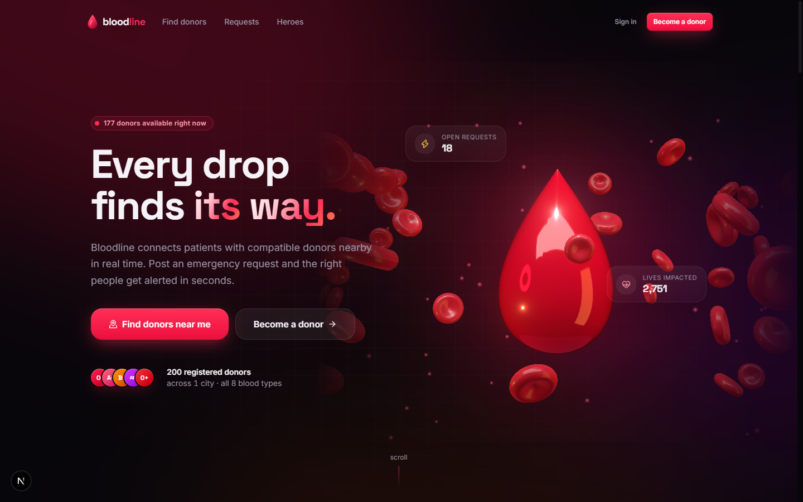
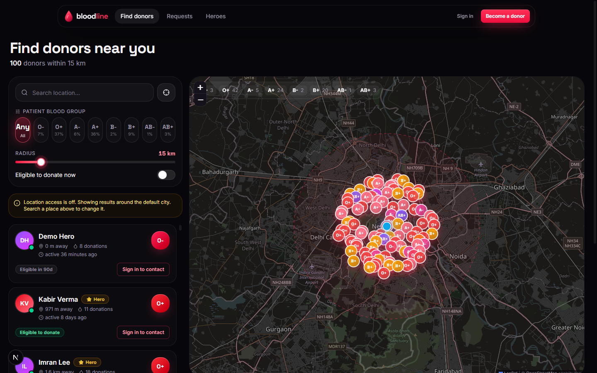
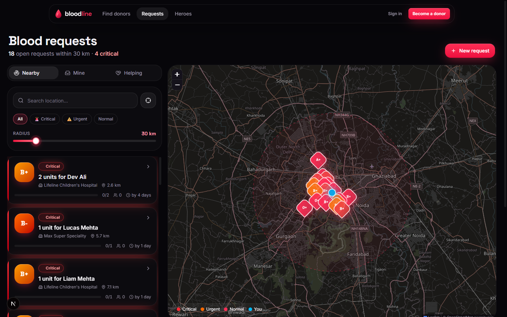
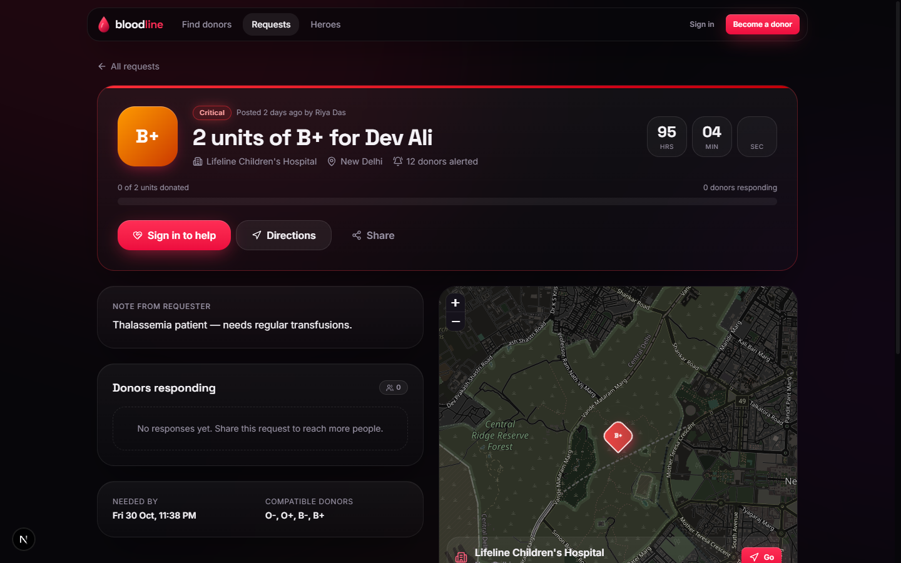
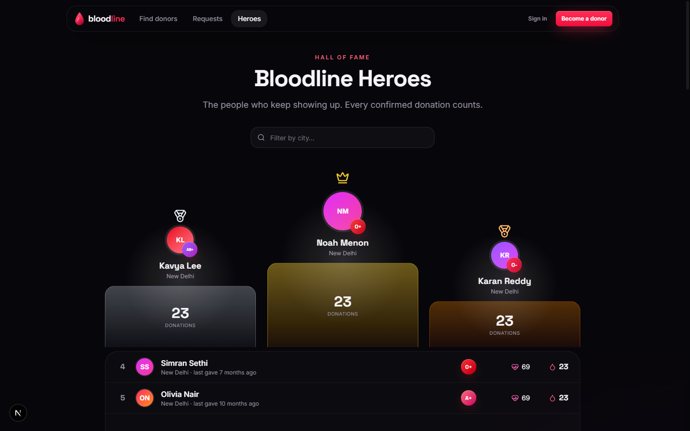
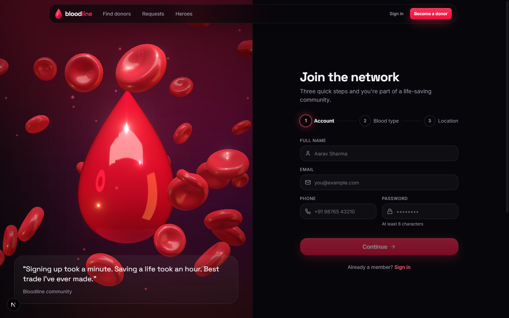
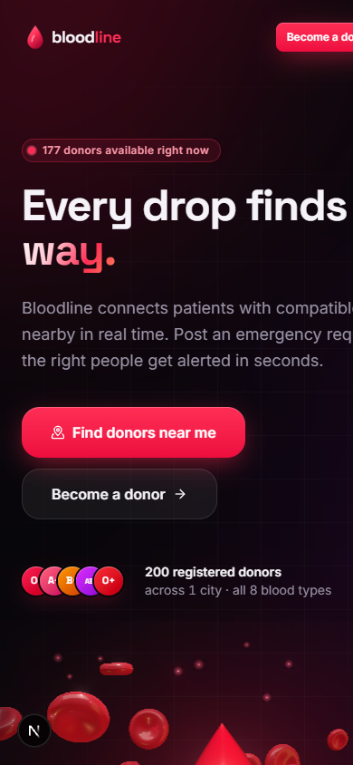
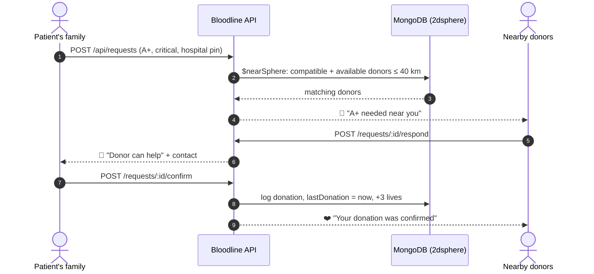
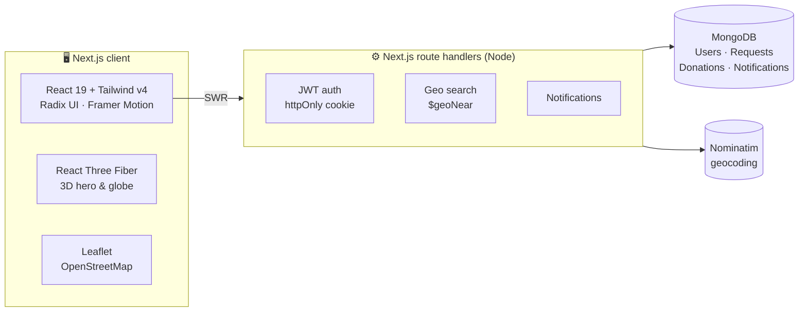

<div align="center">



<br/>

<a href="#-quick-start"></a>


<h3>A real-time, location-based network that connects people who need blood<br/>with compatible donors nearby — in minutes, not hours.</h3>

<a href="#-features">Features</a> ·
<a href="#-screenshots">Screenshots</a> ·
<a href="#-quick-start">Quick start</a> ·
<a href="#-how-it-works">How it works</a> ·
<a href="#-api">API</a> ·
<a href="#-deploy-to-vercel">Deploy</a>

</div>


## 🩸 Why Bloodline?

When someone needs blood urgently, families still forward the same WhatsApp message to hundreds of people and hope. **Bloodline replaces that with geo-matching:** a request goes straight to donors who are *compatible*, *eligible* and *close by*, and they can respond in one tap.

<table>
<tr>
<td width="33%" align="center">📍<br/><b>Geo-matched</b><br/><sub>MongoDB <code>2dsphere</code> + <code>$geoNear</code> rank donors by real distance</sub></td>
<td width="33%" align="center">🚨<br/><b>Urgency-aware</b><br/><sub>Critical requests alert donors up to 40 km away, normal ones 15 km</sub></td>
<td width="33%" align="center">🧬<br/><b>Compatibility-smart</b><br/><sub>All 8 blood groups, with red-cell compatibility applied automatically</sub></td>
</tr>
<tr>
<td align="center">⏱️<br/><b>Eligibility tracking</b><br/><sub>90-day donation interval with a live countdown ring</sub></td>
<td align="center">🔔<br/><b>Live notifications</b><br/><sub>In-app notification centre with toast pop-ups</sub></td>
<td align="center">🔒<br/><b>Privacy first</b><br/><sub>Phone numbers only for signed-in users; responder contacts only for the requester</sub></td>
</tr>
</table>


## ✨ Features

- **🗺️ Find donors**: live dark map plus list, filter by blood group, *include all compatible types*, radius slider (1–100 km) and *eligible now*. Call or WhatsApp a donor in one click.
- **🚑 Emergency requests**: pin the hospital on a map, set units, urgency and deadline. Compatible available donors nearby are notified instantly.
- **🤝 Respond & confirm**: donors offer to help; the requester sees who's coming, calls them, confirms each donation (which credits the donor and resets their eligibility) and marks the request fulfilled.
- **⏳ Request page**: live countdown, progress bar, responders, directions and a share button.
- **📊 Dashboard**: availability toggle, eligibility ring, impact stats, *people nearby you can help*, local blood-group mix chart, 12-month donation history, achievements.
- **🏆 Hero board**: leaderboard with a 3D-tilt podium, filterable by city.
- **🎨 3D & motion**: React-Three-Fiber hero (liquid blood drop, orbiting red blood cells, bloom), a draggable 3D donor globe, spotlight cards, magnetic buttons, number tickers and marquees. The 3D falls back gracefully when WebGL isn't available.
- **📚 Learn**: an interactive compatibility matrix and a 30-second *Can I donate?* checker.


## 📸 Screenshots

<table>
<tr>
<td colspan="2"><p align="center"><sub><b>Landing</b>: 3D blood drop and live network stats</sub></p></td>
</tr>
<tr>
<td width="50%"><p align="center"><sub><b>Find donors</b>: geo search on a live map</sub></p></td>
<td width="50%"><p align="center"><sub><b>Live requests</b>: sorted by urgency and distance</sub></p></td>
</tr>
<tr>
<td width="50%"><p align="center"><sub><b>Request</b>: countdown, responders, directions</sub></p></td>
<td width="50%"><p align="center"><sub><b>Hero board</b>: top donors</sub></p></td>
</tr>
<tr>
<td width="50%"><p align="center"><sub><b>Sign up</b>: 3-step wizard with map location</sub></p></td>
<td width="50%" align="center"><p align="center"><sub><b>Mobile</b>: fully responsive</sub></p></td>
</tr>
</table>


## 🚀 Quick start

> **Requirements:** Node.js 20+. No MongoDB install needed for local dev.

```bash
git clone https://github.com/shubhamjh15/blood-donor-network.git
cd blood-donor-network
npm install
```

```bash
# Terminal 1: local MongoDB (downloads a mongod binary on first run; data persists in ./.mongo-data)
npm run db

# Terminal 2: seed demo data, then start the app
npm run seed
npm run dev
```

Open **http://localhost:3000** and click **✨ Try the demo account** on the sign-in page.

| Demo login | Password |
|---|---|
| `demo@bloodline.app` | `demo1234` |

> 💡 `npm run dev:all` starts the database and the app together.
> 🌍 To seed around your own city: `SEED_LAT=19.076 SEED_LNG=72.8777 SEED_CITY=Mumbai npm run seed`

<details>
<summary><b>🧪 Try the full flow with two accounts</b></summary>

1. **Window A**: sign in with the demo account → **Request blood** → choose **A+**, *Critical*, pin a hospital → post.
2. **Window B (incognito)**: **Become a donor** with blood group **A+** near Delhi.
3. **Window B**: the 🔔 shows the alert → open it → **I can donate**.
4. **Window A**: you're notified → open the request → the donor's phone is visible → click **Donated**.
5. **Window B**: you get a ❤️ thank-you, your donation count goes up and the eligibility ring starts its 90-day countdown.

</details>


## 🧠 How it works





### 🧬 Compatibility rules (red cells)

| Recipient | Can receive from |
|:---:|:---|
| **O−** | O− |
| **O+** | O−, O+ |
| **A−** | O−, A− |
| **A+** | O−, O+, A−, A+ |
| **B−** | O−, B− |
| **B+** | O−, O+, B−, B+ |
| **AB−** | O−, A−, B−, AB− |
| **AB+** | Everyone (universal recipient) |


## 🧱 Tech stack

| Layer | Tools |
|---|---|
| **Frontend** | Next.js 15 (App Router), React 19, TypeScript, Tailwind CSS v4, Radix UI (shadcn-style components), Framer Motion, SWR, Sonner, Recharts |
| **3D** | three.js, @react-three/fiber, @react-three/drei, @react-three/postprocessing (bloom) |
| **Maps** | Leaflet + React-Leaflet, OpenStreetMap tiles, Nominatim geocoding (no API keys) |
| **Backend** | Next.js route handlers on Node, Mongoose 8, Zod validation, bcrypt, JOSE JWT, edge middleware |
| **Database** | MongoDB with `2dsphere` indexes (local `mongodb-memory-server` or MongoDB Atlas) |

<details>
<summary><b>🗂 Project structure</b></summary>

```
src/
├─ app/
│  ├─ api/               REST API (route handlers)
│  │  ├─ auth/           register · login · logout
│  │  ├─ me/             current user (GET/PATCH)
│  │  ├─ donors/         geo search
│  │  ├─ requests/       list/create · [id] · respond · confirm
│  │  ├─ donations/      history + self-reported
│  │  ├─ notifications/  feed + mark read
│  │  └─ stats/ leaderboard/ geocode/
│  ├─ find/ requests/ dashboard/ profile/ heroes/ login/ register/
├─ components/
│  ├─ ui/                Button, Card, Dialog, Select, Tabs, Switch, Slider…
│  ├─ three/             3D hero, globe, WebGL-safe wrapper
│  ├─ map/               Leaflet map + location picker
│  └─ landing/ dashboard/
├─ lib/                  db, auth, blood rules, validators, client hooks
└─ models/               User, BloodRequest, Donation, Notification
scripts/                 local-db.mjs · seed.ts
```

</details>


## 🔌 API

<details>
<summary><b>View all endpoints</b></summary>

| Method | Endpoint | Description |
|---|---|---|
| `POST` | `/api/auth/register` | Create account (sets session cookie) |
| `POST` | `/api/auth/login` · `/api/auth/logout` | Session management |
| `GET` `PATCH` | `/api/me` | Current user / update profile, location, availability |
| `GET` | `/api/donors?lat&lng&radius&bloodGroup&compatible=1&eligibleOnly=1` | Nearby donors sorted by distance |
| `GET` | `/api/requests?scope=nearby\|mine\|responded&lat&lng&radius&urgency&canHelp=1` | Requests |
| `POST` | `/api/requests` | Create request and alert nearby compatible donors |
| `GET` `PATCH` | `/api/requests/:id` | Detail / set status (owner only) |
| `POST` `DELETE` | `/api/requests/:id/respond` | Offer / withdraw help |
| `POST` | `/api/requests/:id/confirm` | Requester confirms a donor donated |
| `GET` `POST` | `/api/donations` | Donation history / log a donation |
| `GET` `PATCH` | `/api/notifications` | Feed / mark read |
| `GET` | `/api/stats` · `/api/leaderboard` · `/api/geocode` | Public data |

</details>


## ▲ Deploy to Vercel

1. Create a free **MongoDB Atlas** cluster (M0). Under **Network Access**, allow `0.0.0.0/0`.
2. Seed it from your machine: `MONGODB_URI="<atlas uri>" npm run seed`
3. Import this repo on **Vercel** and add environment variables:

| Variable | Value |
|---|---|
| `MONGODB_URI` | your Atlas connection string |
| `JWT_SECRET` | any long random string |

4. Click **Deploy**.


<div align="center">

**⚕️ Disclaimer:** Bloodline helps people find each other; it is not a medical service.<br/>Eligibility rules are simplified. Always follow your blood bank's screening.

<br/>

<sub>Made with ❤️ for every life a donor saves.</sub>

</div>
